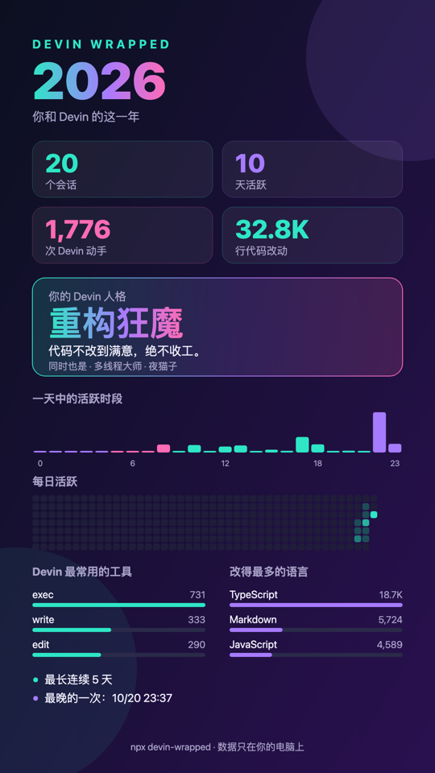
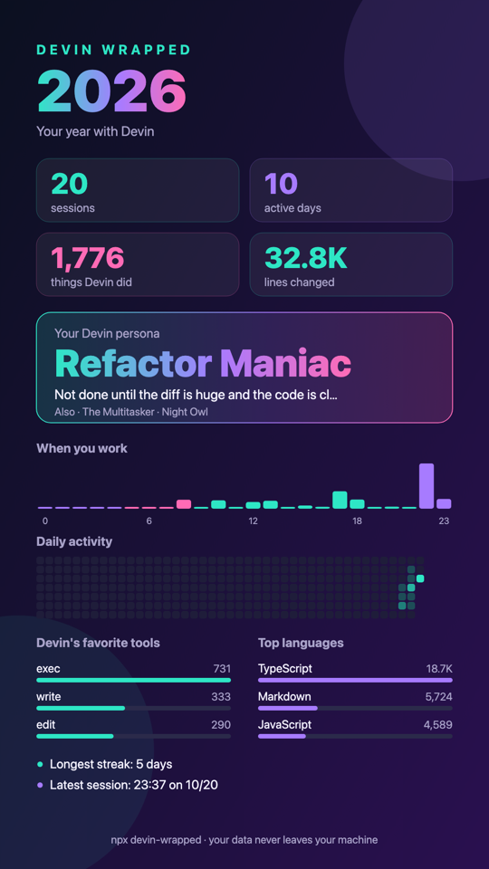

# devin-wrapped

**你和 Devin 的这一年，一张图说清楚。** Spotify Wrapped 风格的 Devin 年度报告：会话数、连续活跃天数、
改了多少行代码、Devin 最爱用的工具、最晚熬到几点，还有你的 **Devin 人格**。

Your year with Devin, Spotify Wrapped style — as a 1080×1920 card made for sharing.

```bash
npx github:kaili-yang/devin-wrapped
```

<p align="center">
  
  
</p>

Reads the local session store that Devin CLI and Devin Desktop share (`~/.local/share/devin/cli/sessions.db`),
read-only. **Nothing is uploaded**, and the card shows no project names, paths or prompt text.

## Usage

```bash
npx github:kaili-yang/devin-wrapped               # this year
npx github:kaili-yang/devin-wrapped --days 30     # last 30 days
npx github:kaili-yang/devin-wrapped --all --lang en
```

| Option | |
|---|---|
| `--year <yyyy>` | calendar year (default: this year) |
| `--days <n>` | the last *n* days instead |
| `--all` | everything in the store |
| `--lang zh\|en` | card language (default: your system locale) |
| `--out <dir>` | output folder (default: `./devin-wrapped-<period>`) |
| `--db <path>` | another session store (or `DEVIN_SESSIONS_DB`) |
| `--json` | raw stats as JSON |
| `--no-png` / `--no-open` | skip the PNG / don't open the result |

You get `devin-wrapped-2026.svg`, `.html` and — when Chrome, Chromium, Edge or Brave is installed (or `CHROME_PATH`
is set) — a ready-to-post `.png`. Without a browser, open the HTML and click **Save as PNG**.

The terminal also gets a summary with the private bits (top projects, longest session title, top commands):

```
  DEVIN WRAPPED  2026

  20 个会话   10 天活跃   1,755 次 Devin 动手
  +32.0K / -328 行代码改动, 313 个文件

  你的 Devin 人格: 重构狂魔 — 代码不改到满意，绝不收工。
  同时也是: 多线程大师, 夜猫子

  一天中的活跃时段  0h         ▂ ▁▁▁▁▁▁▁▃▂▁▁▁█▂ 23h
  ...
```

## Personas

The persona whose signal beats its threshold by the widest margin wins; up to two runners-up appear as tags.

| Persona | 人格 | Signal |
|---|---|---|
| Night Owl | 夜猫子 | ≥ 25% of activity between 22:00 and 05:00 |
| Early Bird | 早起鸟 | ≥ 20% between 05:00 and 09:00 |
| Weekend Warrior | 周末战士 | ≥ 35% on weekends |
| The Delegator | 甩手掌柜 | ≥ 15 Devin actions per prompt |
| The Spec Writer | 产品经理 | prompts average ≥ 300 characters |
| Refactor Maniac | 重构狂魔 | ≥ 5,000 lines changed |
| Terminal Ninja | 命令行侠客 | ≥ 45% of actions are shell commands |
| The Researcher | 研究员 | ≥ 10% of actions are web searches / fetches |
| The Multitasker | 多线程大师 | ≥ 4 sessions in one day |
| Steady Builder | 稳健型工程师 | none of the above |

## What is counted

| Card | Source |
|---|---|
| sessions / active days / streak / heatmap / hours | your and Devin's messages, local time |
| things Devin did | tool calls in Devin's messages |
| lines changed / languages | diffs of Devin's file edits (multiset line diff, by file extension) |
| favorite model | `generation_model` of Devin's replies (compaction excluded) |
| latest night | the latest message between 00:00 and 05:00 (else the latest after 21:00) |

When Devin compacts a long conversation, older turns are replaced by a summary in the store, so very long sessions
are under-counted: treat the numbers as lower bounds. Cloud (app.devin.ai) sessions are not in the local store.

## Development

Node ≥ 22.13 (uses the built-in `node:sqlite`), zero dependencies.

```bash
npm test                                   # builds a fixture store with Devin's schema
node bin/cli.js --days 7 --out /tmp/dw     # against your real store
```

MIT © Kelly Yang
